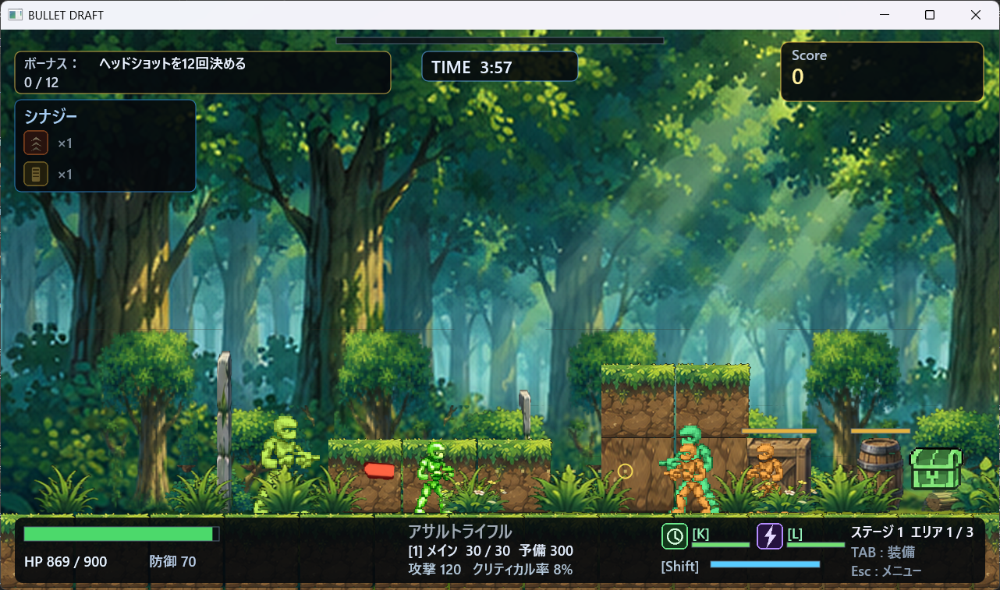

# BulletDraft

C++ / DirectX で制作したゲーム作品です（作者：Hwang Yie shyan）。

## フォルダ構成

- `Source/` … ソースコード・Visual Studio プロジェクト（`BulletDraft.sln`）
- `Game/` … 実行ファイル `BulletDraft.exe` と素材（`Assets/sound`, `Assets/texture`）
- `BulletDraft_作品説明書.pdf` / `.docx` … 作品説明書
- `プレイ動画1.mp4`, `プレイ動画2(音声なし).mp4` … プレイ動画
- `プレイ画面1〜3.png` … スクリーンショット

## 遊び方

`Game/BulletDraft.exe` を実行してください（Windows）。

